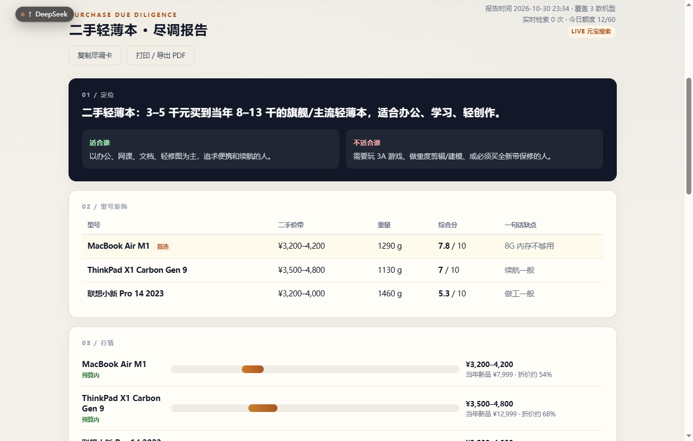
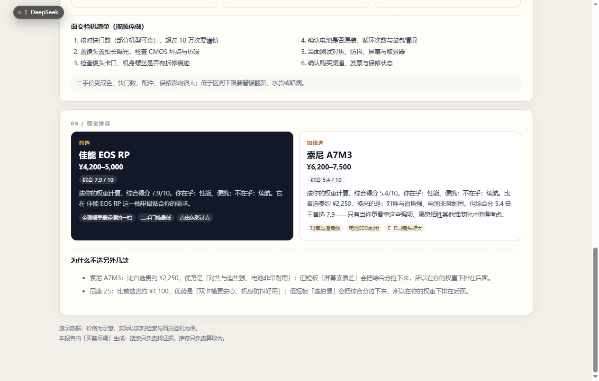

# buy-check · 买前尽调

> 二手数码买前决策卡：输入「想买什么 + 预算 + 在乎什么不在乎什么」，输出一张可查账的尽调报告。
> 不荐货，只做尽调——每条价格线索都带来源和抓取时间，能点回原文。



## 这是什么

给「买二手数码之前」做的功课工具。它不替你做决定，而是把做决定需要的事实整理好：

- **决策卡模式**：选品类（相机 / 轻薄本 / 手机 / 平板 / 耳机）、填预算、勾在乎项，输出五张卡——定位、型号矩阵、行情、避雷与验机清单、取舍推荐。推荐会明确告诉你「这个钱不该加」，而不是无脑吹。
- **自由检索模式**：任意关键词 + 价格区间 → 整理好的链接清单。每条结果提取价格线索，标注「命中区间 / 区间外 / 未识别」，不限品类。

两条设计原则：

1. **搜索当证据，不当结论**。行情来自元宝搜索（SearchPro）实时检索，每条线索带 URL、站点、发布日期和抓取时间；可信的价格线索还会反过来修正打分基准价。
2. **打分用规则，不用模型**。同一个输入，今天和明天算出的分数必须一样。



## 快速开始

零第三方依赖，Python 3.10+ 即可：

```bash
git clone https://github.com/213f08/buy-check.git
cd buy-check
cp .env.example .env        # 填入 YUANBAO_API_KEY（腾讯云控制台「元宝搜索 → 服务 API KEY」领取）
python server.py            # 打开 http://127.0.0.1:8010
```

不填密钥会进入 mock 模式（无实时搜索，其余功能正常），方便先看界面。

有 Docker 的话等价于：

```bash
docker compose up -d --build
```

## 工作原理

行情能力全部来自元宝搜索的 `SearchPro` 接口，系统分两层：

- **精选数据层**（人工校对）：机型参数、评分、通病、验机清单——保证稳定；
- **实时证据层**（搜索）：每个候选机型检索「二手 价格 行情」，返回的条目带 URL、站点、发布日期和抓取时间——保证新鲜。

实时检索到的价格会先做**句级归因 + 跨型号隔离**（「EOS RP 4500元，A7M3 6500元」绝不会把 6500 算给 EOS RP），再按可信度聚合：≥2 条线索且离散度可控的价格带，才会修正打分基准价并在界面上标注「实时修正」；单条或来源价差过大的只展示、不参与打分。

打分公式：

```
价格分 = 1 - (基准价 - 最低) / (最高 - 最低)
便携分 = 1 - (重量 - 最轻) / (最重 - 最轻)
其他   = 评分 / 10
权重：最在乎 2.5，最不在乎 0.15，其他 1.0
```

推荐位按判定表给出：首选 / 省钱选 / 加钱选，加钱选如果综合分低于首选会明确写出来。改预算和偏好时，前端用同一套规则即时重算，不重新搜索。

## API

| 接口 | 说明 |
|---|---|
| `POST /api/advise` | 决策卡：`{query, budget_min, budget_max, care, ignore}` |
| `POST /api/search` | 自由检索：`{query, price_min, price_max}`，返回带价格标注的链接清单 |
| `GET /api/health` | 运行模式与当日额度 |

服务内置：每 IP 限流（默认 20 次/分）、请求体上限（64KB）、每日搜索限额与自动降级（额度用完或密钥失效时，报告照常输出精选数据并明示）。

## 接元宝搜索的几个坑

踩过的，记下来省你时间：

1. **服务 API KEY 的入口藏得深**。控制台默认引导 AK/SK，其实「服务 API KEY」（sk- 开头）用 `Authorization: Bearer` 直连就行，零依赖。
2. **`Pages` 是字符串数组**。每条结果是 JSON 字符串，要逐条 `json.loads`。
3. **`Mode` 传 1 会静默返回空结果**，不报错，就是空。
4. **`Cnt` 只接受 10/20/30/40/50**，其他值报参数错误，需要做吸附。
5. **API KEY 模式下 `authority_level` 返回为空**，部分来源没有日期，前端要兜底。
6. **价格提取要防两类误读**：盘点页里别人的价格（按句归因 + 逗号切子句隔离），以及裸数字（「快门2万次」没有「元」不收）。

## Roadmap

- [ ] 浏览器插件：逛闲鱼时选中商品一键尽调
- [ ] 更多品类：游戏本、相机镜头
- [ ] 同一说法的时间线核查

## 测试

```bash
python -m unittest discover -s tests -v
```

62 个用例：推荐引擎、线索价抽取与归因、自由检索整理、限流器、HTTP 集成（真实 socket）。

## 免责声明

精选数据层的价格带与评分为人工整理的参考数据，行情线索来自实时搜索；购买决策请以面交验机为准。本项目不接联盟链接、不带货。

本项目由作者与 AI 结对完成，架构与取舍由作者负责。

## 文档参考

- [元宝搜索产品页](https://cloud.tencent.com/product/wsa)
- [API 快速入门](https://cloud.tencent.com/document/product/1806/121812)
- [服务 API KEY 方式](https://cloud.tencent.com/document/product/1806/130615)
