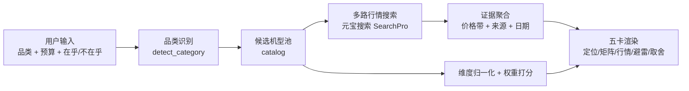

# 买前尽调 · 二手数码决策卡

> 输入「想买什么 + 预算 + 最在乎/最不在乎」，输出一张**可解释的购买尽调报告**：
> 定位 / 型号矩阵 / 行情 / 避雷与验机 / 取舍推荐。

**参赛方向**：元宝搜索开发者征文大赛 · 竞品情报 / 数据核查
**一句话卖点**：不荐货，只做尽调——告诉你钱花在哪、坑埋在哪、以你的需求该选谁。

---

## 1. 为什么这个题不俗

市面上「AI 导购」都是：输入预算 → 推荐一款 → 带联盟链接。
「买前尽调」反着做：

| 常见 AI 导购 | 买前尽调 |
|---|---|
| 推「最好的」 | 讲清**取舍**：你不在乎什么，就能省什么 |
| 只卖新货 | **二手行情 + 验机清单**是一等公民 |
| 一段话结论 | 五张**结构化卡片**，每条结论有来源 |
| 信息来自模型记忆 | 价格/评测/通病来自**实时搜索** |

核心差异：**不是「帮你选」，是「帮你排除」**——排除不合适的型号、不合理的价格、不靠谱的机器。

## 2. 输出的五张卡

| # | 卡片 | 内容 |
|---|---|---|
| 01 | **定位卡** | 这个品类是什么档位、适合谁、不适合谁 |
| 02 | **型号矩阵** | 3–5 款候选 × 价格/重量/综合分/一句话缺点 |
| 03 | **行情卡** | 二手价带、当年新品价、折价率、预算匹配 |
| 04 | **避雷卡** | 各机型通病 + 面交验机清单 |
| 05 | **取舍推荐** | 首选 / 省钱选 / 加钱选 + 「为什么不选其他」 |

第 05 张是产品灵魂。示例：

> 你最在乎「画质、便携」，明确不在乎「续航」→ **首选佳能 EOS RP**：485g、二手 4–5k，续航短板正好被你避开了；
> 如果你愿意加钱上镜头群 → **A7M3**，但你得多背 165g、多花约 ¥2,250。

## 3. 功能清单

**双模式**：

- **决策卡模式**：五个品类（相机/轻薄本/手机/平板/耳机），精选数据 + 权重打分 + 五卡报告；
- **自由检索模式（最小 MVP）**：任意关键词 + 价格区间 → 整理后的链接清单——
  每条结果提取价格线索并标注「命中区间 / 区间外 / 未识别价格」，支持按价格排序。
  不限定品类、不做权重打分，搜「4090 二手」「富士 X-T4」都行。

**MVP（已实现）**
1. 自由检索：任意关键词 + 价格区间 → 整理链接（价格线索标注 + 排序）
2. 品类识别：二手相机 / 二手轻薄本 / 二手手机 / 二手平板 / 二手耳机
3. 预算筛选 + 需求维度打分（在乎权重 2.5、不在乎 0.15、其余 1.0）
4. 五张决策卡渲染；**偏好/预算变更客户端即时重算（0 API 调用）**
5. 推荐解释：首选 / 省钱选 / 加钱选 + 「为什么不选其他」
6. **实时线索价反哺**：句级归因 + 跨型号隔离，可信价格带修正打分基准与预算判定
7. 复制尽调卡 / 打印导出 PDF
8. 元宝搜索接入：Live 模式为每个机型抓「二手价格/行情」证据（带 URL 与抓取时间）
9. 额度防护：单请求预算、6 小时查询缓存、每日限额、月度用量记录；额度用完自动降级

**P1**
- 浏览器插件：逛闲鱼/京东时选中商品 → 一键尽调
- 价格历史曲线（多源价格归一化）
- 自定义维度权重滑块
- LLM 自动抽取评测/参数（替代当前 catalog 演示数据）

## 4. 架构



- 无密钥 → **mock 模式**：用 `catalog.py` 的演示数据跑完整流程；
- 有密钥 → Live 模式：每个候选机型发起 `{型号} 二手 价格 行情` 搜索，把真实链接附到报告里。

## 5. 打分逻辑

```
属性归一化（0–1）：
  价格   = 1 - (二手中间价 - 最低) / (最高 - 最低)
  便携   = 1 - (重量 - 最轻) / (最重 - 最轻)
  其他   = 评分 / 10

用户权重：
  最在乎 = 2.5   最不在乎 = 0.15   其他 = 1.0

综合分 = Σ(权重 × 属性) / Σ权重
```

推荐位：
- **首选**：综合分最高
- **省钱选**：比首选便宜且综合分最高的机型
- **加钱选**：比首选贵、综合分最高的机型

## 6. 快速开始

```bash
cd buy-check
python server.py            # http://127.0.0.1:8010
python -m unittest discover -s tests -v
```

接真实元宝搜索（**已联调通过**）：复制 `.env.example` 为 `.env`，填入 `YUANBAO_API_KEY`（服务 API KEY，`sk-` 开头，零依赖直连）或腾讯云 AK/SK，重启即可。无密钥自动 mock。
Live 模式实测：单次搜索 0.7s、单份报告 3 次搜索；同机型 1 小时内命中缓存不扣额度；额度用完自动降级为精选数据模式。

**部署上线**：完整步骤（轻量服务器 / systemd / nginx / 安全清单 / 额度账本）见 [DEPLOY.md](DEPLOY.md)。
Live 模式行为：每个候选机型实时检索「二手 价格 行情」证据并展示可点击来源；每日额度用完自动降级为精选数据模式，服务不中断。

## 7. API

`POST /api/advise`（决策卡模式）

```json
{
  "query": "二手相机",
  "budget_min": 4000,
  "budget_max": 8000,
  "care": ["performance", "portability"],
  "ignore": ["battery"]
}
```

返回：`category / matrix / market / avoidance / recommendations / why_not / meta`

`POST /api/search`（自由检索模式）

```json
{ "query": "尼康 Z5 二手 价格", "price_min": 4000, "price_max": 6500 }
```

返回：`items[]`（每条带 `prices` 价格线索与 `price_hit`: 命中/区间外/未识别）、`total`、`hits`、`usage`。

## 8. 参赛文章方案

**标题候选**
- 《不荐货，只做尽调：用元宝搜索给二手数码做一张「买前决策卡」》
- 《我让元宝搜索查了 9 款二手数码，总结出一张「不踩坑」尽调报告》
- 《把「评测、行情、避雷」变成五张卡：二手数码购买决策助手》

**目录**
1. 开场：买二手最怕的不是贵，是不知道自己买的是什么
2. 为什么普通导购解决不了：它推荐货，不解释取舍
3. 架构：从一句「想买二手相机」到五张卡
4. 核心①：品类识别与候选池
5. 核心②：多路搜索与行情证据（元宝搜索参数设计）
6. 核心③：需求权重打分与「为什么不选其他」
7. 核心④：避雷卡与面交验机清单
8. 实测：15 款机型、5 个品类、N 条证据、推荐命中率
9. 额度与成本：每单 3–9 次搜索，2000 次/月怎么够用
10. 展望：插件、价格曲线、LLM 抽取

**建议实测数据**
- 10 位朋友的真实选购需求 → 人工判断 vs 系统推荐的一致率
- 每个品类跑 3 个预算档，统计推荐变化是否合理
- 单份报告平均搜索次数与耗时

## 9. 注意

- `catalog.py` 里是**演示数据**，价格与评分不是实时行情；文章里要写清楚，避免误导；
- 接真实搜索后，每条价格都要带**抓取日期**，并提示「以面交验机为准」；
- 不接联盟链接、不带货，保持「尽调」的中立人设；
- 二手验机清单是建议，不构成专业检测结论。
