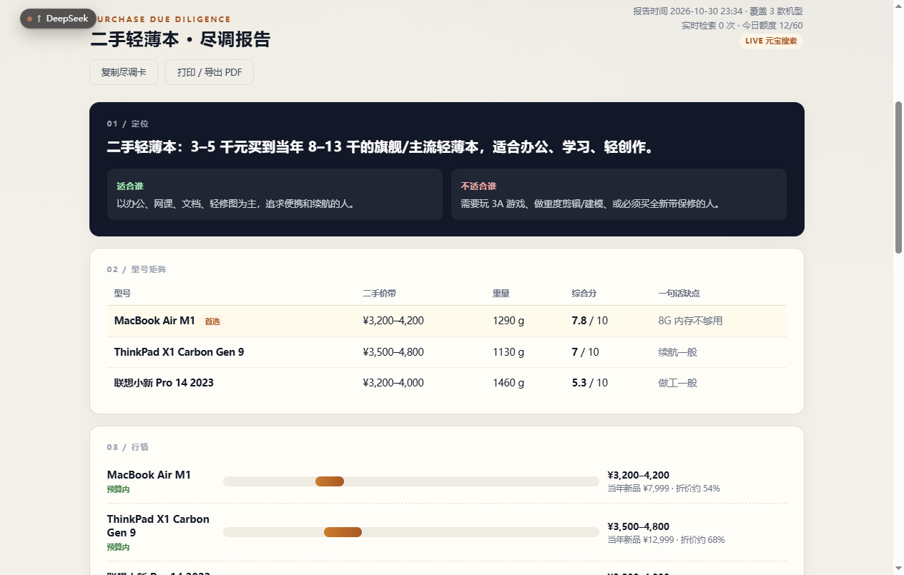
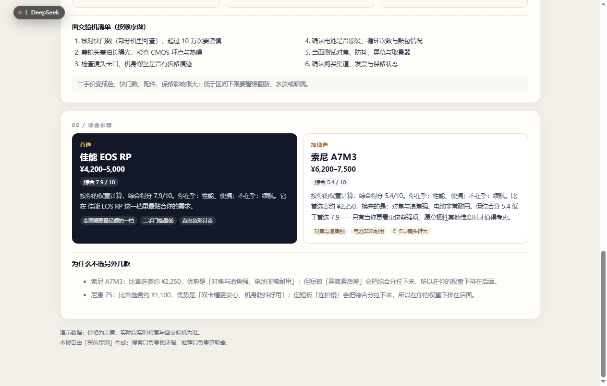
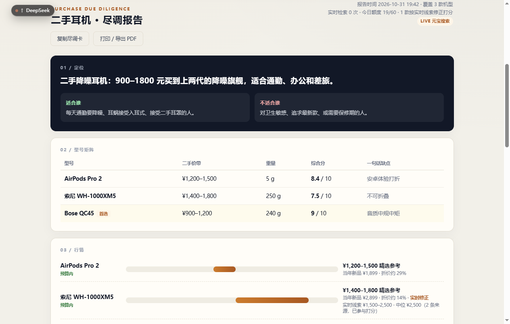
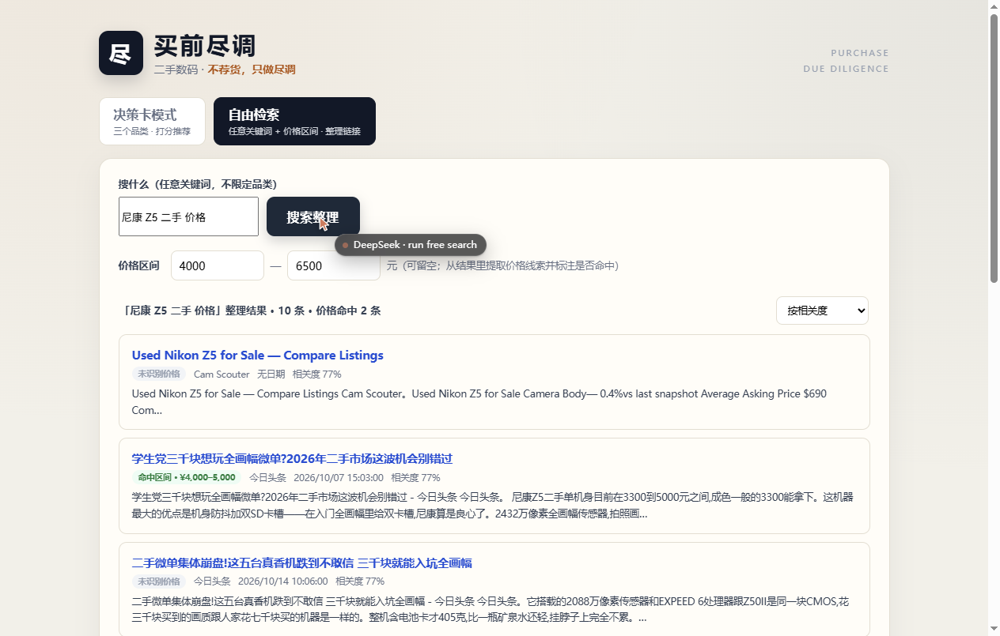
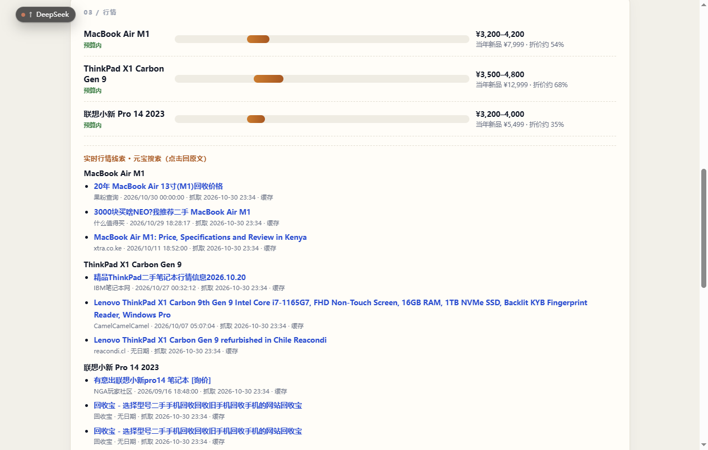

# 【元宝搜索开发者征文大赛】不荐货，只做尽调：用元宝搜索给二手数码做一张「买前决策卡」

先交代背景。这是一个本地跑的小工具：你输入想买的二手数码、预算、在乎什么不在乎什么，它输出一张「尽调卡」——几个候选机型的价带、通病、验机清单，还有一个带取舍解释的推荐。行情这块的底座全是元宝搜索的实时检索：每条价格线索都挂着出处和抓取时间，能点回原文。顺便说一个我自己挺意外的细节：整个项目没有写过一行「清洗网页 HTML」的代码。这不是偷懒，是真的不需要——为什么，第三节说。

| 项目 | 内容 |
|---|---|
| 作品阶段 | 可演示原型（完整源码 + 32 个单元测试） |
| 参赛方向 | 调研分析 |
| 完整源码 | https://github.com/213f08/buy-check |
| 技术栈 | Python 标准库 + 原生 HTML/JS + 元宝搜索 SearchPro，零第三方依赖 |
| 元宝搜索参与环节 | 运行时给每个候选机型搜「二手行情」；做精选数据层的时候也靠它做调研和核对 |
| AI 参与说明 | 代码是我和 AI 一起写的，架构和取舍我自己定；文中截图和数据都是真实跑出来的，没修过图 |

**目录**：一、为什么做这个 二、五张卡和两种模式 三、为什么非得接搜索 四、检索词和参数 五、几个关键实现 六、搜索到底带来了什么 七、实测数据 八、怎么跑起来 九、踩坑 十、后面打算

## 一、为什么做这个

去年帮朋友收一台二手微单，功课做了一晚上：评测翻到眼睛花，回收平台一个价、闲鱼一个价、个人出价又一个价，论坛里的「通病帖」还得自己一条条挖。最后朋友问我「那到底买哪个」，我发现我给不了一个能让他放心的答案——我说的每句话他自己都得再查一遍。

后来又遇到几次类似的事（帮人选笔记本、自己看耳机），才想明白问题在哪：二手这东西的信息是**碎的、旧的、还掺着带货的**。评测不说价格，回收平台不说缺点，论坛帖真假掺半。而「AI 导购」类产品基本不管这些，输入预算吐一个商品链接，背后连着佣金。

所以我想做的东西很具体：不替你做决定，但把你做决定需要的东西**整理好、标上出处**。查得到就给你看来源，查不到就直说没有。就这么个定位：不荐货，只做尽调。



## 二、五张卡和两种模式

主界面是决策卡模式。选品类（现在有相机、轻薄本、手机、平板、耳机五个）、填预算、勾一下最在乎和最不在乎什么，出来五张卡：

1. **定位卡**：这个档位适合谁、不适合谁；
2. **型号矩阵**：候选机型放一起比价、比重量，各给一个综合分；
3. **行情卡**：二手价带、折价率，标注你的预算够不够；
4. **避雷卡**：每个机型的通病，外加一份面交验机清单；
5. **取舍推荐**：首选、省钱选、加钱选，每条都解释为什么。

举个真实的输出。权重是「在乎画质便携、不在乎续航」：

> 首选佳能 EOS RP（7.9 分）：全画幅里最轻便的一档，二手门槛也最低——续航短这个毛病正好被你不在乎了。
> 加钱选索尼 A7M3（5.4 分）：贵两千二左右，换来对焦和镜头群。但综合分是低于首选的，除非你后面想认真玩，否则不值。

第三句是我刻意让它写的。很多推荐工具只会说 A 好 A 妙，不会告诉你「其实你不该加这个钱」。



另外还有一个自由检索模式，就是「任意关键词 + 价格区间 → 整理好的链接列表」，不限品类，后面细说。

## 三、为什么非得接搜索

这个决策我一开始是绕过弯路的：想着直接问大模型「A7M3 二手多少钱」不就行了？

不行。模型嘴里的价格是训练语料里的旧价格。二手行情是分钟级在变的，通病和批次问题散落在回收平台和论坛里，同一个机型因为成色差价能到 20%。这些东西时效强、特别碎，还掺着大量卖货的软文——恰好是搜索擅长、参数记忆不擅长的东西。

所以我在这个项目里给搜索定的角色很明确：**它不给答案，它给证据**。决策卡上每个价格带、每次「行情变了」的修正，背后都得是能点开回溯的搜索结果。说白了，用户第一次可以「查账」。

至于为什么选元宝搜索，不只是检索质量，更主要的原因是它的返回确实是「为 AI 应用重新做过的」。产品页上的原话是「信息自动去噪」「大模型可直接使用无需二次处理」——这句话在我这里不是宣传语，是可以量化的：全项目零行网页清洗代码，`passage` 字段拿进来直接进判定逻辑。其他几个官方卖点，我也逐一对了实测：

| 官方产品页说的 | 我实测到的 |
|---|---|
| 「大模型友好」，返回免二次处理 | 全项目零行 HTML 清洗代码，`passage` 直接用 |
| 「分钟级更新」 | XM5 行情被炒高当天，检索就带回了新价格，还触发了「实时修正」 |
| 「毫秒级响应」（官方口径最快 300ms） | 我实测端到端 0.68–0.9 秒，含网络往返和解析 |
| 「支持 Skill / MCP / API 三种接入」 | 我选了服务 API KEY 直连，标准库搞定，零依赖 |
| 「叠加腾讯内容生态」 | 搜回来的行情帖里有 NGA、什么值得买、各地回收站——恰好是二手功课最难找的中文内容 |

具体怎么把搜索接进来、搜什么词，下面说。

## 四、检索词和参数

每个候选机型固定发三路检索：

| 路 | 检索词 | 想拿到什么 |
|---|---|---|
| ① | `{型号} 二手 价格 行情` | 回收参考价、个人出价帖 |
| ② | `{型号} 评测 优缺点` | 横向对比观点 |
| ③ | `{型号} 通病 故障 避雷` | 批次问题、翻新识别 |

目前版本为了省额度只发了第①路，②③路的解析管线是一样的，属于复制粘贴级别的扩展。

参数上有两个坑提前说一下。`Cnt` 服务端只认 10/20/30/40/50，我传 7 直接报错，所以写了个吸附函数，传多少都会被归到最近的合法值。`Mode` 固定用 2——社区里有人实测过 Mode=1 会静默返回空结果，不报错，就是空，这种坑最阴。另外行情类检索我没限定 `Industry`，因为回收价来源太杂了，收窄反而丢信息。

自由检索模式则反过来，用户输入什么关键词就原样透传给元宝搜索，检索词的设计权完全交给用户。

## 五、几个关键实现

### 接入：API KEY 直连，连 SDK 都不用装

元宝搜索对外有三种接法：API、MCP、Skill（官方产品页的提法）。对开发者来说，API 这条线里又有两种认证：腾讯云 AK/SK 签名（要装 SDK），或者「服务 API KEY」（sk- 开头那串）。我用的后者，标准库直接 POST：

```python
def _apikey_search(self, query: str, cnt: int) -> list[SearchPage]:
    body = json.dumps({"Query": query, "Cnt": cnt, "Mode": 2},
                      ensure_ascii=False).encode("utf-8")
    request = urllib.request.Request(
        "https://api.wsa.cloud.tencent.com/SearchPro",
        data=body,
        headers={"Authorization": f"Bearer {self.api_key}",
                 "Content-Type": "application/json"},
        method="POST",
    )
    with urllib.request.urlopen(request, timeout=20) as resp:
        data = json.loads(resp.read().decode("utf-8"))
    self._raise_tc_error(data)
    return _parse_pages(data)
```

实测一次搜索 0.7 秒上下，返回 10 条。因为不需要 SDK，整个项目一个第三方依赖都没有，服务器上连 pip install 都省了。

有个字段差异要提一下：API KEY 模式下 `authority_level` 返回是空的（好像和 AK/SK 的档位有关），个别来源也没有日期。我的处理是前端老老实实显示「未知」「无日期」，不拿别的东西凑。

### 打分：让「不在乎」变成真金白银

打分是纯规则，没有任何模型参与：

```
价格分 = 1 - (基准价 - 最低) / (最高 - 最低)
便携分 = 1 - (重量 - 最轻) / (最重 - 最轻)
其他   = 评分 / 10
权重：最在乎 2.5，最不在乎 0.15，其他 1.0
综合分 = Σ(权重 × 属性) / Σ权重
```

推荐位也是查表：分最高的当首选；有比首选便宜的当「省钱选」；有更贵的且分差不大就给「加钱选」，分差太大也给，但会明确写「综合分低于首选，除非你更看重这些强项」。

为什么不用大模型来「综合评估」？因为分数要能复现。读者拿计算器按一遍，也得是这个数。

这里有个我自己被打脸的事。写测试的时候我预设「在乎性能和屏幕」的话 iPad Pro 应该是首选，结果引擎选了 iPad Air 5，我以为是 bug，手算了一遍：Air 5 八点二，Pro 八点一，差在基准价便宜一千一。引擎是对的，我的直觉是错的，改测试去了。

### 实时线索价：这一块翻车最多，也最值得说

前面说过搜索要「当证据」，但把搜索结果摆出来只是第一步。真正的难点是：**怎么从一堆帖子里把「这个型号现在值多少钱」可靠地抠出来**。

我的做法是三步。

第一步，句级归因：一句话里同时出现型号别名和价格，这个价格才认。不然「2026年10月相机回收参考价：佳能、索尼、尼康、富士40款机型」这种盘点页，40 个型号的价格全得算错。

第二步，逗号隔离。这是我写测试时才炸出来的问题：「EOS RP 4500元，A7M3 6500元」——句号级切分下这是一个句子，6500 就被算给 EOS RP 了。中文里这种写法太常见了。所以又按逗号切了一层：子句里有本型号别名就收；没有别名、但整句里出现过别的型号，就不收；整句没提别的型号，允许看相邻子句（不然「小新pro14，3200元出」这种最普通的出帖格式就漏了）。专门写了个污染测试盯着这个 case。

第三步，可信聚合。两三条线索凑一起，极差超过中位数四成的（不同成色、渠道混报）就不算可信，只展示不参与打分。单条线索也只展示。

这套东西上线后是真起作用的。有天索尼 XM5 的行情被炒高，线索中位 2500，比我的参考带 1400–1800 高出一截，系统直接在页面上标了「实时修正」，折价率和分数都按新价重算过。还有一次尼康 Z5 搜到两条可信的低价线索，把 A7M3 从「加钱选」的位置上挤下去了。行情变了，推荐真的会动。

当然也有边界要交代清楚：线索价是「页面里出现过的价格」，不是成交价；裸数字（后面不带「元」的）我一律不收，不然「快门2万次」也会被当成价格。宁可少收点，也别把别人的价格算到它头上。



### 改预算不用重新搜

打分是纯函数这个特点还有个好处：我把同一套规则在前端也实现了一份。预算框一动、偏好一点，分数、矩阵、推荐立刻重排，页面上会提示「已按当前预算与偏好实时重算（行情线索未重新检索）」。零次 API 调用，体验上就是「实时」。

### 额度：公开 Demo 的命门

元宝搜索每月免费额度有限，一份决策卡要搜 3 次。挂到公网让人随便点，不做防护一天就烧完了。我做了三件事：每天限 60 份（落盘计数）；同机型查询 1 小时内走缓存不扣额度；额度用完或者密钥出问题，报告照样出（用精选数据），页面上写清楚「未联网刷新」。反正就是不能白屏，不能让评委点开是个报错。

### 自由检索：不限品类

五张卡做完我发现品类还是写死的，搜「富士 X-T4」就不行。于是加了第二个模式：任意关键词加价格区间，返回整理好的链接列表。每条结果提取价格线索，标注「命中区间」「区间外」或者「没识别到价格」，可以按价格排序。搜「4090 二手」也没问题。



## 六、搜索到底带来了什么

这个项目天然有一组对照：不接搜索（只用我人工整理的精选数据）和接了搜索（精选 + 实时证据）。同一份相机报告，差异是这样的：

| | 不接搜索 | 接元宝搜索 |
|---|---|---|
| 行情数据 | 静态参考带，没来源没日期 | 每机型 3 条证据，带链接和抓取时间 |
| 价格可信度 | 只能写「仅供参考」 | 可信线索会修正基准价，能回原文 |
| 行情变了 | 报告不会变 | XM5 被炒高那次，直接标「实时修正」重算 |
| 推荐位 | 永远一样 | Z5 凭两条低价线索进过「加钱选」 |

得说明边界：这不是严格的对照实验，样本就一份，也没做盲评。但它支撑了整个产品的判断——没有实时搜索，行情卡上每个数字都只是「我上次看到的」；有了它，才算能查账。

顺带一提，元宝搜索产品页里有句话，说搜索面对的用户正在从「人」变成「智能体」，要把排序信息交给 AI 帮它判断结果价值。这次我算是用一个小工具亲身体验了一遍：搜索返回的 `score`、日期、结构化的 `passage`，本来就不是给人看的排版，而是给程序做判定用的原料。我的打分引擎吃的正是这些东西。



## 七、实测数据

本地真实跑出来的：

- 单次搜索 0.68–0.9 秒，每次返回 10 条；
- 一份决策卡端到端 2.1 秒左右（含 3 次搜索）；
- 命中缓存时 0 次搜索；
- 改预算重算 0 次 API 调用；
- 现在 5 个品类 15 款机型，32 个单元测试全过。

搜索带回来的内容也确实对路。举几条原样的结果：「2026年10月相机回收参考价:佳能､索尼､尼康､富士40款机型」（大象数码回收）、「2026全画幅别乱买:二手微单掀了桌子」（今日头条）、「3000块买NEO?我推荐二手 MacBook Air M1」（什么值得买）、「有意出联想小新pro14 笔记本 [淘价]」（NGA）。回收参考价、横向观点、个人出价帖，正好是做二手功课最难找的三类东西。传统搜索给你一列链接就完了，这里是把它们挂到了具体的机型和决策下面。

## 八、怎么跑起来

1. 拿到源码（git clone 或者下压缩包）；
2. 复制 `.env.example` 为 `.env`，填入 YUANBAO_API_KEY（腾讯云控制台「元宝搜索 → 服务 API KEY」那里领）；
3. `python server.py`，浏览器开 http://127.0.0.1:8010 。没有 pip install，因为零依赖。

想挂成在线服务的话，systemd 和 nginx 的配置我放在仓库 DEPLOY.md 里了。

## 九、踩坑

1. **服务 API KEY 的入口藏得深**。控制台默认引导你走 AK/SK，其实「服务 API KEY」（sk- 开头）用 Bearer 直连就行，个人开发者省掉签名和 SDK，建议先找这个。
2. **Pages 是字符串数组**。每条结果是一段 JSON 字符串，得逐条 loads，直接序列化整个数组会得到双层转义。
3. **API KEY 模式下 authority_level 返回空**。前端要兜底。
4. **日期格式不统一**。有 `2026/10/17 23:05:00` 这种，也有干脆没有的，展示原值加兜底就行。
5. **价格正则第一版我写的是 `\d{2,6}`**，跑测试发现「1.2万」匹配不上——小数点前只有一位。改成 `\d{1,6}` 之后，「3 元贴膜」这种噪声靠合理价格区间过滤兜底。
6. **逗号污染**，就是 5 里说的那个，测试抓出来的。
7. **裸数字不提取**，理由同上。
8. **Windows 控制台打印结果会报 UnicodeEncodeError**。数据没问题，是 cp936 打不出个别字符，设 PYTHONIOENCODING=utf-8 就好。排查的时候别被它带偏，我在这上面浪费了十分钟。

## 十、后面打算

做完最大的感受是：搜索 API 的价值不在「给你信息」，在「给你的结论当证据」。搜索结果从「结果列表」变成「证据链」之后，产品可信度是完全不同的东西。官方把元宝搜索定位成「大模型时代的外脑」，说搜索面对的用户正在从人变成智能体——做完这个项目我是真信了，而且觉得这话对个人开发者同样成立：你写的下一个 AI 应用，多半也需要这么一个「外脑」。

后面想做三件事：浏览器插件（逛闲鱼时选中商品一键尽调）；继续加品类（游戏本、相机镜头，catalog 加一个品类就几十行）；以及试试用 LLM 离线做精选数据层的抽取——注意是离线，人工校对完再入库，不让幻觉进运行时。

如果你也在做「外部信息 + 结构化判断」这类东西，欢迎交流。额度守卫、降级策略、判定表这些设计随便抄。

## 参考资料

1. 元宝搜索产品页：https://cloud.tencent.com/product/wsa
2. API 快速入门：https://cloud.tencent.com/document/product/1806/121812
3. 服务 API KEY 方式：https://cloud.tencent.com/document/product/1806/130615
4. 产品动态：https://cloud.tencent.com/document/product/1806/121792

---

*声明：卡里的价格带和评分是我人工整理的参考数据，行情线索来自实时搜索，买不买请以面交验机为准。本工具不接联盟链接，不带货。*

*标签：#AI搜索 #元宝搜索 #腾讯云 #Python #二手交易*
